# 卡五星麻将 · 单机版

[](https://github.com/fanqiezi/ka-wu-xing/actions/workflows/tests.yml)
[](LICENSE)

湖北三人麻将「卡五星」（随州/襄阳一带玩法）的离线单机版：**你 + 两个电脑**，纯静态网页，双击即玩。

* 🌐 **在线试玩 / 装到桌面**：<https://fanqiezi.github.io/ka-wu-xing/> （手机浏览器打开会自动切手机版布局；「添加到主屏幕」就是个全屏 app，断网也能玩）
* 📦 **仓库**：<https://github.com/fanqiezi/ka-wu-xing> · 发布包：[v1.1.0](https://github.com/fanqiezi/ka-wu-xing/releases/tag/v1.1.0)

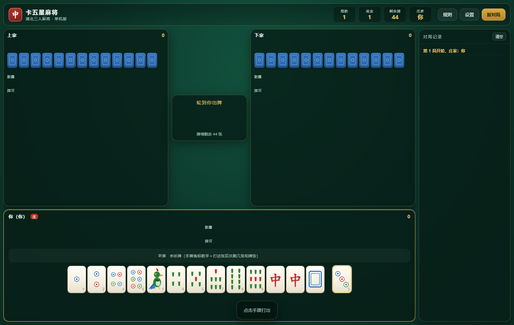

听牌时会直接把「听什么牌、还剩几张」标出来，出牌时每张手牌上还有角标提示打这张之后能听什么：

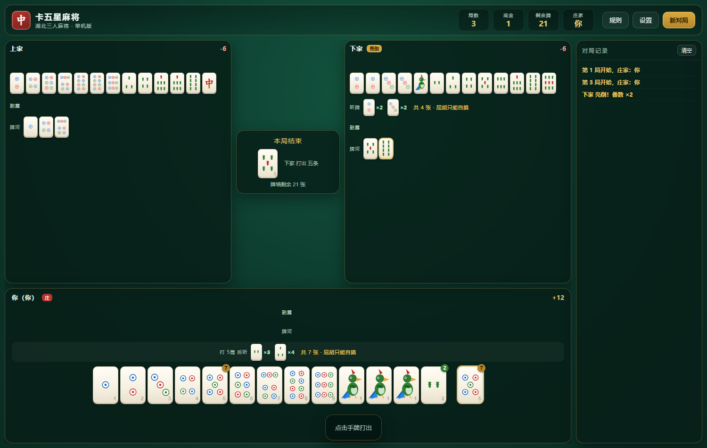

---

## 快速开始

* 双击 **`启动游戏.cmd`**，或直接双击 **`index.html`**
* 打开后先停在**开始游戏界面**（不会一进去就开局），点「开始游戏」才发牌
* 零依赖、零构建、不需要联网、不需要装任何东西（用系统自带浏览器打开即可）
* 手机上打开会自动切到手机版布局（竖屏/横屏都支持），也可以「添加到主屏幕」当 app 用：全屏、**断网也能玩**
* 想跑自测：双击 `运行测试.cmd`（需要 Node.js）

## 手机版

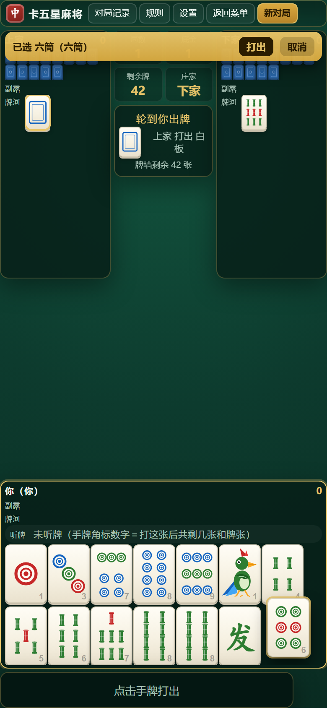

**同一份引擎、同一份界面代码，两套布局**：规则 / 牌局 / AI / 统计一行不改，桌面版外观与交互完全不变。
手机上打开会自动切到手机版布局（指针是触摸 或 屏幕够窄），也可以手动指定：

```
index.html?layout=mobile      自动按屏幕方向选竖屏/横屏
index.html?layout=portrait    强制竖屏
index.html?layout=landscape   强制横屏
index.html?layout=desktop     强制电脑版（手机上想用桌面版时）
```

| | 竖屏 390×844 | 横屏 844×390 |
|---|---|---|
| 布局 | 顶栏一行 · 上家 \| **四个方框（局数/底金/剩余牌/庄家）在中间空当** \| 下家 · 你在下方贴底 · **对局记录收进按钮**（点开是底部抽屉） | **等同电脑版**：顶栏（四个方框 + 对局记录/规则/设置/返回菜单/新对局）· 上家 \| 中央 \| 下家 · 你在下方 · 右侧对局记录栏 |
| 手牌 | **两行 7+7**，一张 50×70（14 张也放得下，不用滑） | 单行 32×46 |
| 牌河 | 对手 5 行、自己 2 行，**超出可上下滑动** | 2 行，超出可上下滑动 |
| 触摸交互 | **二次点击出牌**（第一次点选中并抬起 + 顶部确认条「打出/取消」，第二次点才真打）· **长按 380ms** 看「打这张听什么」· 铳牌点不动并提示 · 按钮 ≥46px | 同左 |
| 其它 | 弹窗（记录/设置/规则/结算）变**底部抽屉**并在内部滚动 · 安全区适配 · 禁止双击缩放 | 同左 |

### 装到桌面（PWA）

打开 <https://fanqiezi.github.io/ka-wu-xing/> 后：

* **Android / Chrome**：菜单里点「安装应用 / 添加到主屏幕」
* **iOS / Safari**：点底部分享 →「添加到主屏幕」（Safari 没有自动安装提示，开始界面里也会提示你这一步）

装完就是一个**全屏、无地址栏**的图标，**断网也能玩**——`sw.js` 会把整个游戏外壳预缓存下来
（发版时改 `sw.js` 里的 `VERSION` 就会换缓存名，旧缓存自动清掉，下次打开即最新）。
`file://` 双击打开的老用法完全不受影响（只在 http(s) 下注册 SW）。

PWA 自检：`node tests/pwa-check.js`（本地起 http 服务，用真实浏览器验证 SW 激活、manifest、
四个图标、预缓存里有没有游戏外壳，然后**真的断网重开一局**）。图标用 `node tests/make-icons.js` 重新生成。

要看真实效果：手机上直接开 <https://fanqiezi.github.io/ka-wu-xing/>，或用
`node tests/shots-real.js`（puppeteer + 本机 Chrome）在 390×844 / 844×390 / 1280×800 三种尺寸下截图 + 自检
（会打印每个区块的真实尺寸、手牌几行、面板有没有重叠、有没有横向溢出）。
`node tests/shots-sizes.js` 会在 **9 种真机尺寸**（320×568 ~ 932×430，含 iPhone SE1 / SE2 / 12 / Pro Max / iPad 的横竖屏）
下逐项自检，并额外跑一遍「对手亮倒」的最坏情况。

之前评审用的两张**纯静态样张**还留着，可以单独点开对比（假数据、不接逻辑，牌面与正式版同一套 SVG）：

* [**竖屏样张**](preview/portrait.html) · [**横屏样张**](preview/landscape.html) · [样张入口](preview/index.html)
* 样张结构与交互的冒烟测试（需要 jsdom）：`node tests/preview.smoke.js`
* 样张截图 + 尺寸（需要 puppeteer-core）：`node tests/shots.js`
  （样张任意一页加 `?measure=1` 会把关键区块尺寸画在页面上；`?state=` / `?hand=` / `?river=` / `?more=1` 可切状态）

## 开始游戏界面

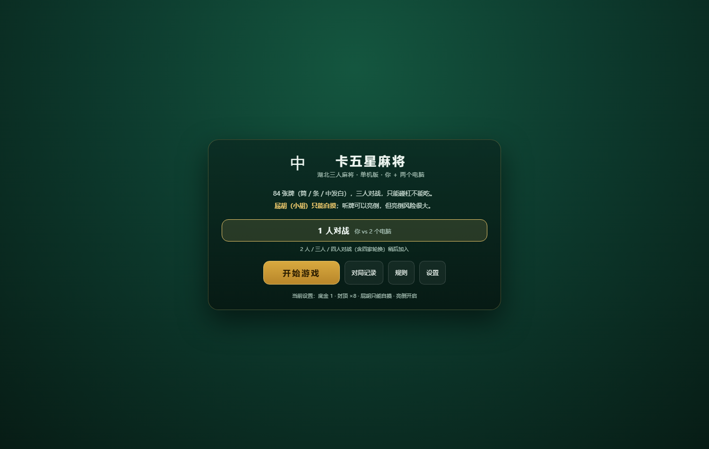

* 打开页面停在菜单，**不会自动开局**。
* 菜单上可以直接点 **对局记录 / 规则 / 设置**，不用先进游戏。
* 点 **开始游戏** 才开一局新的对局（分数、记录都从零开始）。
* 牌桌里右上角有 **返回菜单**，可以随时回到菜单（会先确认）。

> 目前只有「1 人对战（你 + 2 个电脑）」一种模式；2 人 / 三人 / 四人对战（含四家轮换）
> 还没做——那需要先定「多人手牌怎么显示」这类交互，等你确认后再加。

## 对局记录

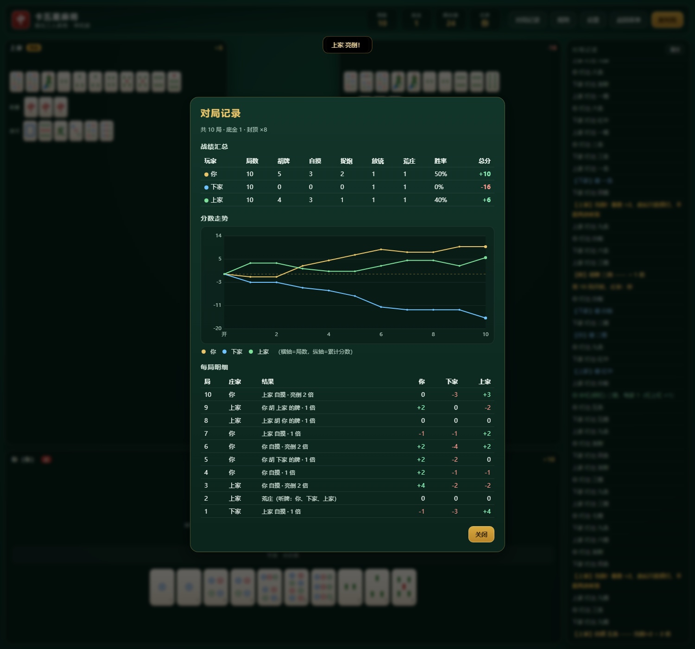

菜单里和牌桌右上角都能打开「对局记录」，里面有：

* **战绩汇总**：每家的局数、胡牌、自摸、捉炮、放铳、荒庄、**胜率**、**总分**。
* **分数走势折线图**：横轴是局数、纵轴是累计分数，每家一条线（canvas 手绘，无依赖），
  中间有一条虚线标出 0 分。
* **每局明细**：倒序列出每一局的庄家、结果（谁胡的、什么番型、多少倍）、以及三家各自的输赢分。
* 点「新对局」会清空记录，重新开始统计。

---

## 听牌提示

* 手牌下方常驻一行 **听牌**：列出所有和牌张（小牌面）和各自剩余张数，并标明是「屁胡只能自摸」还是「N 倍牌型（可捉炮）」。
* 轮到你出牌时，这一行会变成 **「打 X 后听」**，并且**每张手牌右上角会出现一个角标**，数字就是「打掉这张之后场上还剩几张和牌张」。角标是金色的表示那是个屁胡听牌（只能自摸），绿色表示 N 倍牌型（可以捉炮）。
* 鼠标悬停任意手牌，会显示 `打 五筒 → 听 2条×3、3条×4（屁胡，只能自摸）` 这样的完整说明。
* **听牌是私有信息**：只有你自己的听牌会显示出来。对手没亮倒时，界面上不会有任何「听牌」标记——你也不该被对手看出听没听牌。对手**亮倒**之后手牌已经公开，才会连他的听牌一起列出来。

## 亮倒的时机与限制

* **什么时候会问你要不要亮倒**：自己摸完牌之后；以及**碰 / 杠 / 加杠之后**刚变成听牌时也会问
  （碰完之后只问亮倒、不问杠；杠后也一样，先问亮倒再问要不要继续杠）。
* **不想亮倒就直接点手牌出牌**，不用先点「过」再出牌。

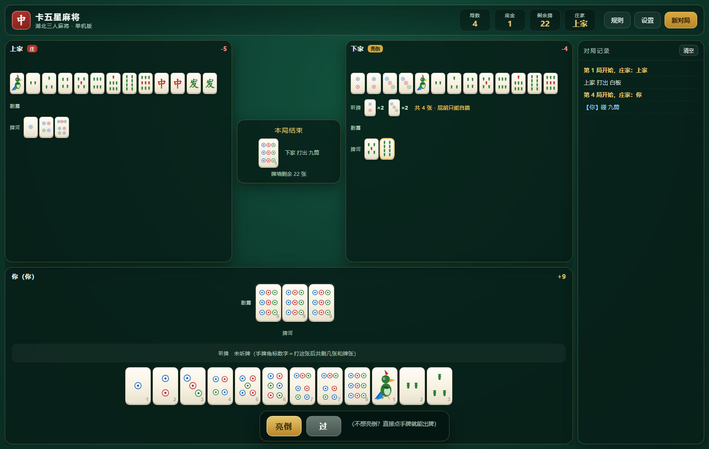

上图是碰完 九筒 之后能听牌的样子：只有「亮倒 / 过」两个按钮，操作栏还提示「不想亮倒？直接点手牌就能出牌」——手牌此时就是可点的。
* 宣布亮倒的那一手可以自由选择留哪张（留完必须仍然听牌）；**从那以后就锁死了**：
  * **只能摸打**——每巡只能打出刚摸到的那张牌，**听张不能再改**；
  * **不能碰、不能杠**（碰会换手牌、杠要补牌，都会改听张），只剩自摸这一条路。
* 界面上，摸完牌后会把**刚摸到的那张单独放在手牌右侧并加金边**；亮倒锁死后其余手牌会变灰不可点，听牌行旁边出现金色标签「已亮倒 · 只能打刚摸的那张」。
* **亮出的牌不插在手牌里**，而是单独占一行摆在手牌下方；**亮倒者的手牌行一律盖着**（只剩亮出的那一行是明牌）。
* **赢张也不插回手牌**：本局结束时，牌桌上、以及结算弹窗里，赢张都是空一格单独摆在手牌右侧并加金边，
  一眼能看出是胡的哪张（自摸赢家的手牌也不会变成 14 张连排）。

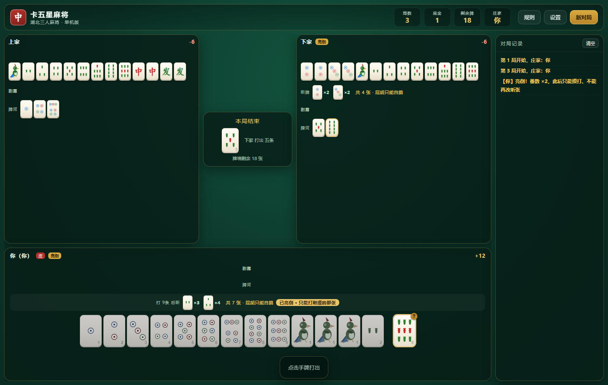

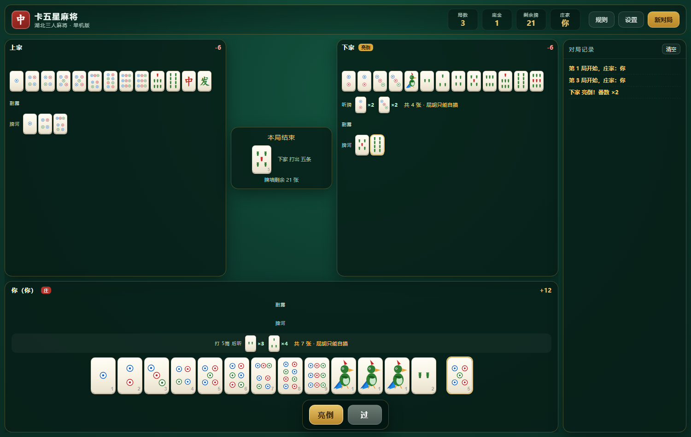

上图就是摸完牌问你要不要亮倒的样子：刚摸的 5筒 单独拎在右边，听牌行直接告诉你「打 5筒 后听 2条×3、3条×4（共 7 张 · 屁胡只能自摸）」，鼠标悬停「亮倒」按钮还会提示「番数 ×2，但手牌公开、亮倒后点炮要赔双倍」。

---

## ★ 关于「屁胡可以捉炮赢」这个 bug

你提到的原版问题，本版按**通行规则**修掉了。

**规则依据**：卡五星的计分规则里，小胡（屁胡）是「基础分值（底金 ×1）」，而且各地通行做法是
**底金 ×1 的小胡只能自摸胡，不能逮炮（捉炮）**——参见 [百度百科·卡五星麻将](https://baike.baidu.com/item/%E5%8D%A1%E4%BA%94%E6%98%9F%E9%BA%BB%E5%B0%86/4205824)
「胡牌分值」一节原文：*「小胡计分（即屁胡）：基础分值（底金×1）（一般设置底金×1的只能自摸胡，不能逮炮）」*。

**本版行为**：

| 牌型 | 自摸 | 捉炮（胡别人打出的牌） |
|---|---|---|
| 屁胡（牌型无番，底 ×1） | ✅ 可以 | ❌ **不允许** |
| 碰碰胡 / 清一色 / 七对 / 卡五星 / 四归一 / 三元 … | ✅ 可以 | ✅ 可以 |

**两个例外**（默认都开启，可在设置里单独关）：

1. **自己亮倒后，屁胡也能捉任何人的炮**——牌都摊开了，就不用再讲「小胡只能自摸」那一套。
2. **亮倒的人打出的牌，屁胡也能胡**——摊了牌就得认，他的弃牌对所有人都是危险牌。
3. **杠上炮**：杠后打出的牌，屁胡也能胡。

* 你听的是屁胡牌时，别人打出来**不会**弹出「胡」按钮，而是给出提示：
  「你本可胡 X筒，但屁胡（小胡）只能自摸、不能捉炮 —— 已按规则拦下」。
* 番型判定按「牌型番」计算：只有碰碰胡/清一色/七对/龙七对/卡五星/四合一/三元/手抓一这些**牌型本身有番**的牌才允许捉炮；
  亮倒、海底捞、杠上开花这类时机番不改变「这手牌是不是屁胡」。
* 想还原成网上那种「屁胡也能捉炮」的玩法，在 **设置 → 屁胡（小胡）只能自摸，不能捉炮** 里取消勾选即可（立即生效，可随时切回）。

**验证**：`tests/rules.test.js` 里有专门的用例组「★ 屁胡不能捉炮（规则修复点）」，
`tests/game.test.js` 里还有流程级的验证——60 局全自动对局中，**每一次点炮胡都断言了 `result.isPitHu === false`**，
只要出现一次屁胡捉炮就会直接测试失败。

---

## 操作说明

| 情况 | 操作 |
|---|---|
| 轮到你出牌 | 直接点手牌打出；鼠标悬停时牌会**向上顶出来**；刚摸到的牌单独放在右侧并有金边 |
| 可以碰 / 杠 / 胡 / 亮倒 | 屏幕下方出现对应按钮，点「过」放弃 |
| 亮倒 | 听牌后可亮倒，手牌对全场公开、**番数 ×2**；亮倒后只能打保持听牌的牌（系统会限制） |
| 看本局结算 | 胡牌 / 荒庄后会弹结算明细（含亮倒者摊开的那几行）；**这个弹窗只能点按钮关**，点旁边不会误关 |
| 查看规则 / 改设置 | 右上角按钮 |

---

## 实现的规则

**牌张**：共 84 张 —— 筒 1-9 各 4 张、条 1-9 各 4 张、中/发/白各 4 张。**没有万子、没有东南西北风**。

**流程**：三人各 13 张，庄家先摸；只能碰、杠，**不能吃**；牌墙摸完无人胡牌即荒庄（荒庄不荒杠）。
首局庄家随机，之后由上一局胡牌者坐庄。

**番型**（**加算**：底金 ×（各番相加），默认 ×8 封顶，双龙七对可到 ×16）：

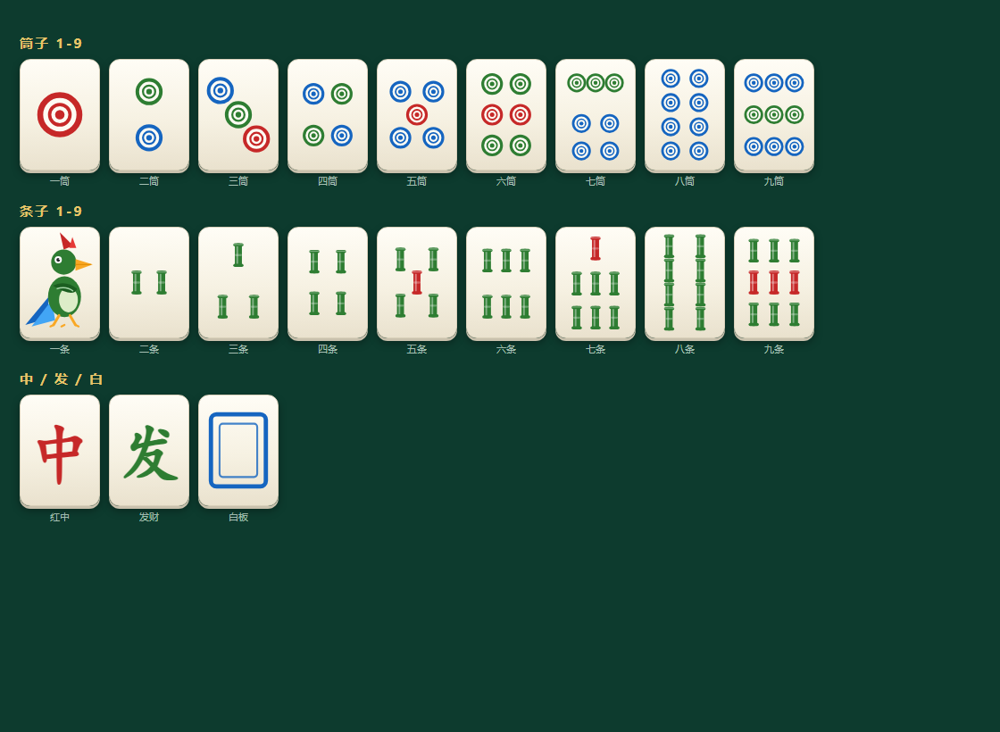

| 番型 | 加分 | 番型 | 加分 |
|---|---|---|---|
| 屁胡（小胡） | 底 ×1（见下） | 清一色 | +4 |
| 碰碰胡 | +2 | 大三元 | +8 |
| 明四归一 | +2 | 小三元 | +4 |
| 暗四归一 | +4 | 手抓一 | +4 |
| 七对 | +4 | 杠上开花 | +2 |
| 龙七对 | +8 | 杠上炮 | **×**（第几杠 × 2） |
| 双龙七对 | +16 | 抢杠胡 / 海底捞 | +2 |
| 卡五星（胡 5 筒/5 条且为 456 嵌张） | +2 | | |

* **番型之间是相加**（不乘算）：底金 5、捉炮、卡五星 + 清一色 → 5 ×（2+4）= **30 分**。
* **杠上炮是唯一的乘算项**：`番数和 =（牌型番 + 加算的时机番）×（第几杠 × 2）`。
  * 底金 5 的**屁胡**被杠上炮（第 1 杠）→ 5 × **1** × 2 = **10 分**；
  * 底金 5 的**清一色**被杠上炮（第 1 杠）→ 5 × 4 × 2 = **40 分**。
* **「底 ×1」只是屁胡的兜底**：**一个番都没有**时加算部分才是 1；只要有任何番就不再另加这个 1
  （例：清一色 + 海底捞 = 4+2 = 6，不是 4+1+2）。
* **亮倒不参与加算**，而是在最后把得分整体 ×2：底金 5 的卡五星 + 清一色再加亮倒 → 5 ×（2+4）× 2 = **60 分**。
* 杠上炮乘完再**封顶**（默认 ×8），所以清一色 + 第 2 杠（4×4=16）也会被封到 ×8。
* 一手的多种拆解会取「番数和最大」的那种（对应规则「只算最大胡牌牌型」）。

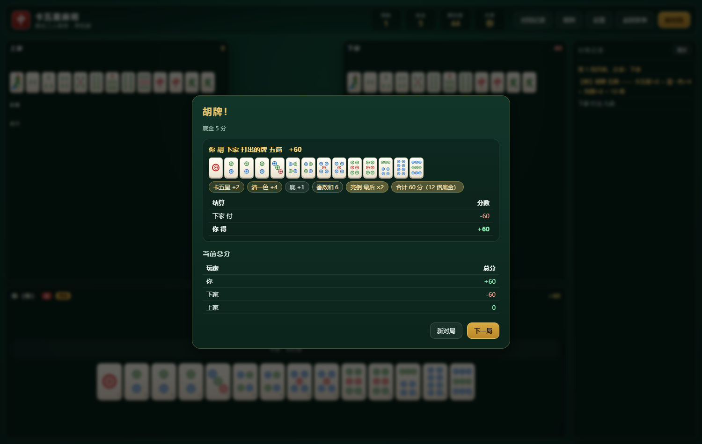

**杠分**（立即结算，与胡牌结果无关）：

| 杠型 | 底数 | 第 1 杠 | 第 2 杠 | 第 3 杠 |
|---|---|---|---|---|
| 加杠（碰后补杠） | 1 倍底金 | 1 倍 | **2 倍** | **4 倍** |
| 暗杠 | 2 倍底金 | 2 倍 | **4 倍** | **8 倍** |
| 直杠 | 2 倍底金（点杠者付） | 2 倍 | **4 倍** | **8 倍** |

* **杠上杠从第二杠起翻倍**，每一步都翻，**每一杠都单独结算**（不是只算最后一杠）。
* 加杠 / 暗杠：其他两家各付；直杠：点杠者一人付。
* **只有加杠（碰后补杠）能被抢杠胡**，暗杠和直杠都抢不了。

**杠上炮**（杠后打出的那张牌被别人胡）：

* 结算 = **底金 × 番数和 ×（第几杠 × 2）**（亮倒再 ×2）：`番数和 = 牌型番 + 加算的时机番`（屁胡兜底 1）。
  第 1 杠 ×2、第 2 杠 ×4、第 3 杠 ×6 —— **杠上炮是乘算**，不是在番数和里加一项。
  底金 5 的屁胡被杠上炮（第 1 杠）= 5 × 1 × 2 = **10 分**；清一色则是 5 × 4 × 2 = **40 分**。
  乘完再封顶（默认 ×8）。
* **杠上炮连屁胡也能胡**——平时屁胡只能自摸，但杠完那一手打出来的牌例外（可在设置里关）。

**结算**：

* 自摸：两家各出一份（赢家得两份）
* 点炮：点炮者出一份
* 点炮**亮倒**的人：默认只出一份（亮倒的 ×2 已经算在番数里了）；设置里可改回「相当于亮倒者自摸，点炮者一人出两份」。
* **亮倒的人输钱一律翻倍**——不管赢家有没有亮倒：
  * 他点炮：赔双倍；
  * 别人自摸：他也要付双倍（没亮倒的另一家照常付一份）。
* 一炮双响：两个赢家都由点炮者付
* **荒庄赔听（查大叫）**：
  * 未听牌者赔给每位**没亮倒的**听牌者，金额 = 底金 × 该听牌者的最大牌型番数；
  * **亮倒的人即使自己也听牌，仍然要赔给其他每个听牌者**，金额同样是「底金 × 对方牌型番数」；
  * **未听牌者不必赔给亮倒的人**（亮倒者自己有赔听义务，别人就不用再赔他了；可用设置改回）；
  * **三家都听牌且无人亮倒 → 互不赔付**（没有任何一方需要赔）；

**其他**：

* **谁都不许故意放铳**：只要有人亮倒，其他人就**不能打出他的听张**（打出去就是白送），哪怕这样会让你自己听不了牌；
  只有手里全是危险张、怎么打都是放铳时才被迫打出去，界面上会把这些牌标成红色的「铳」。

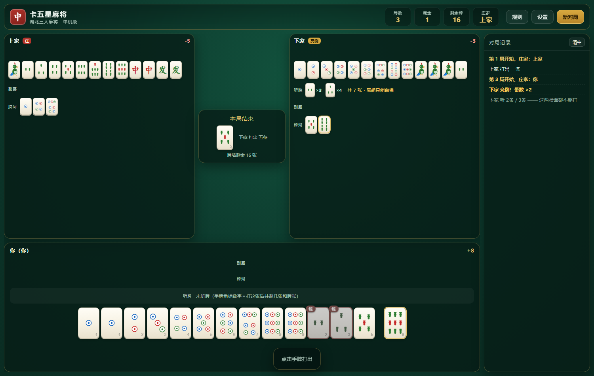

上图里下家亮倒听 2条 / 3条，你手里的 2条、3条就被标红加「铳」、点了也没用，只能从安全牌里挑一张打。
* 漏胡：点炮没胡，过手（自己摸牌）之前不能再胡别人的牌
* 抢杠胡只抢**补杠**，暗杠不抢
* 牌墙摸完后有杠不能杠，打出的牌别人也不能杠

---

## 设置项

| 设置 | 默认 | 说明 |
|---|---|---|
| 底金 | 1 分 | 1 / 2 / 5 |
| 封顶倍数 | ×8 | ×8 / ×16 / 不封顶 |
| **屁胡只能自摸，不能捉炮** | **开** | ★ 本次修复的规则，可关闭还原「可捉炮」玩法 |
| 亮倒的屁胡允许被点炮 | 关 | 仅在上一项开启时生效 |
| 允许亮倒 | 开 | 听牌后亮牌，番数 ×2 |
| **自己亮倒后，屁胡也能捉别人的炮** | **开** | 牌摊开了就不用再讲「小胡只能自摸」 |
| **亮倒后只能摸打，不能再改听张** | **开** | 每巡只能打刚摸的那张，不能碰；补杠/暗杠/直杠仍可 |
| **点炮亮倒者按「相当于自摸」算两份** | 关 | 默认不算：亮倒的 ×2 已在番数里，点炮者只出一份 |
| **不许故意打出亮倒者的听张** | **开** | 迫不得已（手里全是危险张）才允许放铳 |
| **亮倒者输钱一律翻倍** | **开** | 点炮翻倍；别人自摸时也付双倍（不看赢家是否亮倒） |
| **亮倒的人打出的牌，屁胡也能胡** | **开** | 摊牌就得认：亮倒后你的弃牌对所有人都是危险牌 |
| **荒局时亮倒的人要赔听牌者** | **开** | 按其牌型番数赔付 |
| **荒局时未听牌者仍要赔给亮倒者** | 关 | 默认不赔：亮倒者自己有赔听义务 |
| **杠后打出的牌（杠上炮），屁胡也能胡** | **开** | 番数和整体 ×（第几杠 × 2） |
| 结算杠分 | 开 | 暗杠 2 / 明杠 1 / 直杠 2 |
| 荒庄赔听（查大叫） | 开 | 流局时未听牌赔听牌 |
| 电脑思考速度 | 正常 | 快 / 正常 / 慢 |

---

## 项目结构

```
ka-wu-xing/
├─ index.html            页面骨架（含开始界面）
├─ manifest.webmanifest  PWA 清单（全屏、横竖屏都支持、图标）
├─ sw.js                 离线缓存：预缓存游戏外壳，断网也能玩
├─ icons/                桌面图标（192 / 512 / maskable / apple-touch-icon）
├─ 启动游戏.cmd          双击开始
├─ 运行测试.cmd          跑全部自测
├─ css/
│  ├─ style.css          样式（开始界面 / 牌桌 / 牌面 / 弹窗 / 图表）
│  └─ mobile.css         手机版布局（竖屏/横屏两套 + 触摸交互）
├─ js/
│  ├─ tiles.js           牌的编码、名称、牌墙、SVG 牌面绘制
│  ├─ rules.js           胡牌判定、听牌、向听数、番型计分（含屁胡限制）
│  ├─ ai.js              电脑出牌 / 碰杠 / 亮倒决策
│  ├─ game.js            三人牌局状态机（摸打碰杠胡、杠分、荒庄赔听、结算、对局记录）
│  ├─ stats.js           对局记录汇总 + canvas 折线图
│  ├─ ui.js              渲染与交互（含桌面/手机两套布局分支与触摸交互）
│  └─ main.js            启动入口（含 Service Worker 注册）
├─ tests/
│  ├─ rules.test.js      规则引擎自测（41 项）
│  ├─ game.test.js       牌局引擎 + 全自动对局模拟 + 记录统计（47 项）
│  ├─ ui.test.js         界面联调：打桩 DOM 里真跑 ui.js（32 项，含 3 项手机版布局/触摸）
│  ├─ tune-liangdao.js   亮倒模型标定脚本（开发用）
│  ├─ shots-real.js      真实游戏在 390×844 / 844×390 / 1280×800 下截图 + 自检
│  ├─ shots-sizes.js     9 种真机尺寸自检（含「对手亮倒」最坏情况）
│  ├─ pwa-check.js       PWA 自检：SW 注册 / manifest / 预缓存 / **断网还能开局**
│  ├─ make-icons.js      生成 PWA 图标（无头 Chrome 渲染）
│  ├─ preview.smoke.js   手机版样张的冒烟测试（jsdom）
│  ├─ shots.js           样张截图 + 尺寸
│  └─ dom-shim.js        极简 DOM 打桩，供界面测试用
├─ preview/              评审用的静态样张（竖屏/横屏）+ 实机截图
└─ screenshots/          界面截图
```

> `shots-*.js` / `pwa-check.js` / `make-icons.js` / `preview.smoke.js` / `shots.js` 都是**开发用**脚本，
> 需要 `puppeteer-core`（+ 本机 Chrome）或 `jsdom`；仓库本体仍然零依赖、双击 `index.html` 就能玩。

牌面不是字体也不是图片，而是运行时生成的 SVG：筒子画同心圆饼（1筒大红心、5筒红心居中、7/9筒按实物配色），条子画带竹节和两端箍的竹条，一条画麻雀，中发白画字/蓝框。所以不依赖任何字体和网络。

---

## 亮倒：收益、风险，和电脑怎么决定要不要亮

**收益**：亮倒后胡牌番数 ×2（在封顶之后乘，是整体翻倍）。

**风险**：

* **只能摸打**（设置里可关）：亮倒之后每巡只能打出刚摸到的那张牌，**听张不能再改**，也不能碰；
  但 **补杠 / 暗杠 / 直杠仍然允许**（这几样不改变已经定下的听牌型）。
* **只亮关联牌**：亮倒时**只亮出「能凑成赢牌的关联牌」**——手上已经成型的整段（刻子/顺子/将）藏起来，
  只露还在等牌的那一段；**亮出的这几张会单独拿一行展示**，手牌行一律盖着。

  | 手牌 | 听 | 只亮 |
  |---|---|---|
  | `11134567999` + 中中 | 2 / 5 / 8 筒 | **34567** |
  | `1223345578` + 中中中 | 6 / 9 筒 | **78** |
  | `45678` 条 + 111筒 + 999筒 + 中中 | 3 / 6 / 9 条 | **45678** |
  | 纯七对（6 对 + 1 单） | 单骑 | **1 张** |
  | 纯龙七对（1 个四张） | | **3 张** |
  | 纯双龙七对（2 个四张） | | **5 张** |

  **判定标准不是「看起来像不像搭子」，而是「对手能不能从这几张推出你的全部听张」**：
  亮出的牌 T 必须满足「T + 每个听张」都能拆成完整面子、藏起来的部分也能拆成完整面子（一副和牌只有一个将）。
  在这个前提下取**张数最少**的组合。这就是为什么 `11134567999`+中中 里的 `345` **不能藏**——
  藏了对手只能从 `67` 推出 5/8，会漏掉 2 筒；而 `123456789`筒 + 111条 + 5筒 听 5 筒，只亮 **1 张**（5筒）。

  七对一族按 1 / 3 / 5 张单列；但如果这手牌**同时还能按普通牌型多面听**，亮 1 张会漏听张，
  这时会自动退回普通算法（多亮几张，但保证推得出来）。
* **输钱一律翻倍**（设置里可关）。点炮翻倍；别人自摸时你也要付双倍。这一条最狠，也是「屁胡不该亮倒」的主要理由。
* **谁都不许往你的听张上打**（设置里可关）。这条对你是好事（不会被人放铳给你），但也意味着**你几乎只能靠自摸**——别人被迫不喂你。
* **你打出的牌，连屁胡都能胡**（设置里可关）。摊了牌就得认：平时屁胡不能捉炮，但亮倒之后你的弃牌对所有人都是危险牌。
* **荒局还要赔听**（设置里可关）。荒庄时亮倒的人哪怕自己也听牌，仍要赔给每个听牌对手「底金 × 对方牌型番数」。

**电脑用积分制（期望值）决定亮不亮**，把两边都折成「底金」算分 —— **不只看番数**，四个输入都要算：

```
① 剩余抽牌数  turns  = max(1, 牌墙/3) × 0.4   ← 0.4 是实测折算：亮倒之后只能摸打，
                                                平均只再摸到 2~3 张牌，本局就结束了
② 胡牌宽度 / ③ 剩余和牌张数
     p单巡自摸 = 剩余和牌张数 / 还没看见的牌数
     p自摸     = 1 − (1 − p单巡自摸) ^ turns
④ 放铳风险
     对手威胁 threat = 0.6 + 0.8 ×（牌墙消耗比例）+ 0.12 × 对手副露数
     p放铳 = 每巡基础风险 0.010 × turns × threat        （封顶 0.45）

收益 = p自摸 × 2 × 番数 + p点炮胡 × 番数              亮倒后胡牌金额整体翻倍
损失 = p放铳 × 对手平均番数 × (2 × 1.5 × 1.5 − 1)      赔付翻倍 × 不能弃和 × 弃牌更危险
     + p别人先胡 × 对手平均番数 / 2                    亮倒者输钱翻倍 → 每个失局都多付一份
     + p荒庄 × 赔听番数 × 听牌对手数                   荒局亮倒赔听（赔的是对手的番）
期望值 > 门槛(=0.3 ÷ 该牌型的奖惩倾向，屁胡再 ×2) 才亮倒
```

关键在于 **收益跟自己的番数、听张宽度、剩余张数、剩余巡数都成正比，而放铳和赔听的损失只取决于对手**：
屁胡翻倍只多赚一点点，却要承担一样的风险，所以基本不划算；清一色、七对这种高番牌、而且听得宽、牌墙还厚时才值得摊牌。

**奖惩机制（会自己学）**：电脑每亮倒一次就按结果调整「该牌型」的倾向系数 ——

| 结果 | 倾向系数 | 效果 |
|---|---|---|
| 亮倒后胡了 | +0.30（上限 ×2.60） | 门槛 = 0.3 ÷ 倾向 → **同一牌型下次更敢亮** |
| 亮倒后没胡（被别人胡 / 点炮 / 荒庄） | −0.25（下限 ×0.35） | 门槛抬高 → **同一牌型下次更保守** |

倾向按「牌型」分别记（屁胡 / 卡五星 / 七对 / 清一色 / 暗四归一 …），每个电脑座位一套，
战绩连同「亮倒次数 / 赢 / 输 / 当前倾向」一起显示在 **对局记录 → 电脑的亮倒奖惩记忆** 里。
实测：同一局对局连着打 90 局，出现亮倒的局数会从 37% 降到 13%（输过的牌型自动被压下去）。

标定结果（`tests/tune-liangdao.js`，40 局/档）：

| 听牌牌型 | 亮倒决策率 |
|---|---|
| 屁胡（×1） | ~0%（90 局样本里 0 次；门槛额外 ×2） |
| 2 番（碰碰胡/卡五星…） | ~3% |
| 4 番以上（清一色/七对/四归一…） | ~37% |

也就是说「多数对局都在亮牌」已经没有了：**约 30% 的局有人亮倒**（改之前是 70%+），
而且**亮倒的人有 6 成以上是没胡成的**——这也正是奖惩记忆要压下去的行为。
90 局样本里实际亮倒的牌型：暗四归一 15、卡五星 7、七对 4、碰碰胡 3、龙七对 1、清一色 1、**屁胡 0**。

**顺带把「放铳」也压下来了**：亮倒的人只能摸打、等于一直在喂牌给别人，所以实测里
**大多数点炮都是亮倒的人放的**（60 局样本：14 次点炮里 9 次是亮倒者）。亮倒变少之后放铳自然变少；
另外电脑在**对手可能已经听牌**时（牌墙见底、对手副露多）出牌会更保守 ——
「牌河里出现过的牌（现物）」的权重会随对手威胁放大（`chooseDiscard` 里的 `safetyW`），
让它宁可拆一点自己的牌型也不往危险张上送。

也就是说，**屁胡几乎不会亮倒**（只有听得极宽时才偶尔亮），大胡才值得摊牌。
系数都放在 `js/ai.js` 的 `LIANGDAO` 里（`turnEfficiency` 折算剩余抽牌数、`need` 是基准门槛、
`learnUp/learnDown/learnMin/learnMax` 是奖惩记忆的奖惩幅度与上下限），想调直接改；
`node tests/tune-liangdao.js 60` 可以重新标定（会打印决策率、有亮倒的局数、亮倒者胜率、
模型预测的自摸概率与实际胜率的对比、点炮次数）。

---

## 自测

```bash
node tests/rules.test.js   # 规则引擎：胡牌 / 听牌 / 向听数 / 番型 / 屁胡限制
node tests/game.test.js    # 牌局引擎：杠分 / 抢杠 / 荒庄赔听 / 亮倒赔双倍 / 全自动对局
node tests/ui.test.js      # 界面：打桩 DOM 里模拟点击跑 8 局 + 按钮渲染 + 听牌提示
node tests/preview.smoke.js  # 手机版样张的冒烟测试（可选，需要 jsdom；没装就自动跳过）
```

几个比较关键的断言：

* 随机 400 手牌验证「向听数 == 0 ⟺ 有听牌」，以及进张后向听数单调不增
* 全自动对局中：分数零和、牌张守恒（每种牌不超过 4 张）、打牌后 `手牌 + 3×副露 == 13`
* **每一次点炮胡，要么牌型不是屁胡，要么放炮的人已亮倒**（屁胡不能捉炮 + 亮倒者的弃牌例外）
* 杠分金额、杠上杠翻倍、抢杠胡、荒庄赔听、亮倒输钱翻倍（点炮/别人自摸）的精确数值
* 杠分倍数：加杠链 1→2→4 倍、暗杠链 2→4→8 倍，每杠单独结算
* **加算计分**：底金 5 + 卡五星 + 清一色 = 5×(2+4)=30；再加亮倒 = 5×(2+4)×2=60
* **「底 ×1」只在没有任何番时才算**：清一色 + 海底捞 = 5×(4+2)=30（不是 5×(4+1+2)=35）
* **杠上炮是乘算**：`(牌型番 + 加算时机番) × 第几杠 × 2 × 底金`
  —— 屁胡 + 第 1 杠 = 5×1×2=**10**；清一色 + 第 1 杠 = 5×4×2=**40**；清一色 + 第 2 杠 = 4×4=16 → 封顶 ×8
* **只有加杠能被抢杠**：暗杠 / 直杠抢不了
* **所有「自身操作（胡/杠/亮倒）」的询问都必须发生在刚摸完牌之后**，碰完牌不能追问
* **碰完之后能听牌时会问亮倒**（且只问亮倒、不问杠）；问亮倒时可以直接点手牌出牌，不用先点「过」
* **亮倒后只能打出刚摸的那张**（听张锁死），但仍然可以补杠 / 暗杠 / 直杠，只是不能碰
* **亮倒只公开「能推出听张的关联牌」**：藏起已成型整段，只亮还在等牌那一段（例：听 2/5/8 只亮 34567）；
  随机 400 手听牌手牌校验「亮出的牌 + 每个听张都能成和」，保证不会漏掉任何一个听张
* **亮倒的牌单独一行**：亮倒对手的手牌行全是牌背，只有「亮倒」行是明牌；未亮倒的对手不显示听牌
* **赢张单独摆在手牌右侧**（不插回手牌）：牌桌与结算弹窗都是「13 张手牌 + 空档 + 金边赢张」
* **结算弹窗点外面不会关掉**，只能点「下一局 / 新对局」（避免点歪了卡住进不了下一局）
* **结算弹窗的番数和**：底金 5 的屁胡被杠上炮 → 弹窗显示「杠上炮 ×2 · 番数和 2 · 合计 10 分」，且不再显示「底 +1」
* **点炮亮倒者默认只出一份**（不再按「相当于自摸」算两份）
* **不许放铳**：亮倒者的听张会被排除、只剩安全牌可打；手里全是危险张时才 `forced` 放行，并记日志
* **亮倒后屁胡也能捉炮**：没亮倒时被拒、亮倒后被询问「胡」，关掉开关后又恢复拦截
* **荒局赔付的四种组合**：亮倒者赔听牌者、未听牌者不赔亮倒者、打开开关后又赔、无人亮倒且全听则互不赔
* 未亮倒的对手在快照里不会暴露听牌状态
* **对局记录**：每局输赢零和、累计分数与玩家分数一致、点数 = 局数 + 1、新对局会清空记录
* **开始界面**：加载后不自动开局、规则/设置/记录按钮可用、点「开始游戏」才发牌
* **AI 亮倒决策率**：屁胡 < 3%（实测 0%）、大胡在 15%~80% 之间（实测 ~37%），且屁胡明显低于大胡
  （直接统计决策，不用有偏差的「赢牌占比」）；多数对局（>60%）不该有人亮倒
* **AI 亮倒模型的四个输入都真的起作用**：牌墙越少期望值越低、听张越宽自摸概率越高、剩余张数越多越值得亮、
  对手副露越多（威胁越大）放铳损失越大 → 期望值越低
* **亮倒奖惩记忆**：赢过 +0.30 / 输过 −0.25，有上下限（×0.35 ~ ×2.60），直接缩放亮倒门槛；
  接到牌局上验证「赢了上调、输了（含荒庄）下调」，玩家自己亮倒不参与学习
* **对局记录里的亮倒奖惩记忆**：能列出每个电脑座位每种牌型的「亮倒次数 / 赢 / 输 / 当前倾向」
* **电脑出牌安全度**：对手威胁越大（尾盘/副露多），「现物」的权重越高 —— 实测 60 局点炮 14 次，
  其中 9 次是亮倒者被迫摸打放的；亮倒变少之后放铳也随之下降
* 界面：手牌渲染张数与状态一致、按钮文案与点击回传正确、听牌行与落听角标正确、亮倒锁死时只有一张可点、危险张标红且不可点

---

## 规则取舍说明

卡五星各地细则有差异，下面这些地方本版做了明确取舍，都可以在 `js/rules.js` 的 `DEFAULT_RULES` 与 `js/game.js` 里调整：

* **屁胡定义**按「牌型番」算，不含亮倒/海底/杠上花等时机番。
* **亮倒的规则**一共五条，都可单独开关：只能摸打（听张锁死）、输钱一律翻倍、不许故意放铳、弃牌连屁胡都能胡、荒局赔听。
* **亮倒者能捉炮**：自己亮倒后屁胡也能捉任何人的炮（默认开）。
* **宣布亮倒的那一手**允许自由选择留哪张（只要留完仍听牌）；之后每巡只能打刚摸的那张。
* **荒庄赔听**按听牌者的最大牌型番数赔付（亮倒者收赔时该番数同样 ×2）；亮倒者作为赔付方时，赔的是「底金 × 对方牌型番数」，不因其自身亮倒而再加倍。
* **不许放铳**是硬约束：会覆盖「亮倒后只能打保持听牌的牌」——即便安全牌会让你听不了牌，也必须打安全牌。
* **碰完之后可以亮倒**：碰、杠、加杠之后只要能听牌都会问一次；碰完不能杠（杠必须自己摸牌后）。
* **杠上炮**是乘算：`番数和 =（牌型番 + 加算时机番）×（第几杠 × 2）`（×2 / ×4 / ×6），
  与杠分本身的翻倍（×2 / ×4 / ×8）是两套算法。
* **明四归一**只按「该牌自己碰过」判定；**暗四归一**指手上原有三张、胡到第四张（龙七对/双龙七对不再叠加暗四归一）。
* **手抓一**按「4 副碰/杠 + 单骑」判定。
* **海底捞**指摸到牌墙最后一张并自摸。
* 番型封顶默认 ×8，双龙七对例外可到 ×16；**亮倒在封顶之后再整体 ×2**。
* **番型之间是加算**（不是乘算），**杠上炮是唯一的乘算项**，亮倒单独作为最后的整体翻倍。
* **底 ×1 只是屁胡的兜底**：加算部分 =「牌型番 + 加算时机番」，**只有这部分为 0 时才记成 1**；
  所以底金 5 的屁胡本身 = 5×1 = 5，屁胡放杠上炮 = 5×1×2 = 10。
  （实现在 `js/rules.js` 的 `scoreWin`：`baseSum = typeSum + timingSum; if (baseSum === 0) baseSum = 1;`
  然后 `sum = baseSum * gangPaoMul`。）
* **杠上炮是乘算**（×2 / ×4 / ×6 …），乘完再封顶；亮倒最后再整体 ×2。
* **电脑的亮倒**是纯 AI 决策（`js/ai.js` 的期望值模型 + 奖惩记忆），不影响规则本身：
  你能在设置里整体关掉「允许亮倒」，也可以直接改 `LIANGDAO` 里的系数与门槛。

---

## 参考

* 规则：[百度百科 · 卡五星麻将](https://baike.baidu.com/item/%E5%8D%A1%E4%BA%94%E6%98%9F%E9%BA%BB%E5%B0%86/4205824)（牌张构成、番型表、杠分算法、小胡只能自摸等）
* 亮倒细则：[博雅互动 · 卡五星场景问题解答](http://www.boyaa.com/page/service/serinfo04.html)（「听牌后可以将牌亮倒……亮倒后可以自摸也可以胡别人放的炮，但是胡其他玩家需要达到 2 番以上牌型才可以」，与本版「屁胡亮倒也捉不了炮」一致）
* 玩法参考：B 站 up 主 yandra 的卡五星版本（本版针对其「屁胡可以捉炮赢」的问题按通行规则做了修正，并把该条做成可切换的规则开关）

---

## 许可

[MIT](LICENSE) © 2026 fanqiezi。牌面图案、代码、文案都是本项目原创（HTML/CSS/JS 手写，无第三方依赖、无第三方素材）。
建议仅用于个人娱乐与学习；请勿用于任何形式的赌博。
